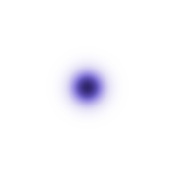
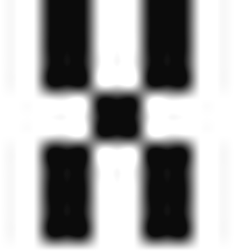
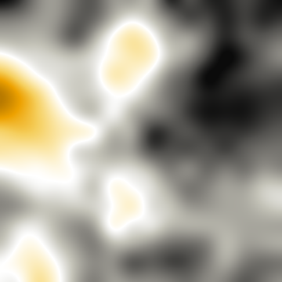
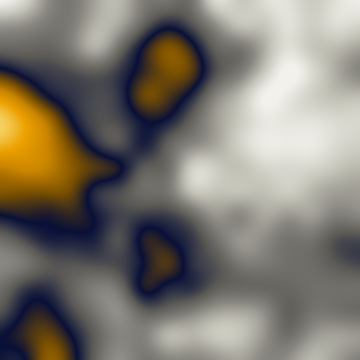
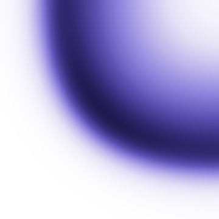
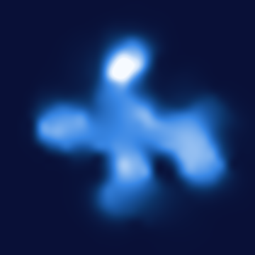
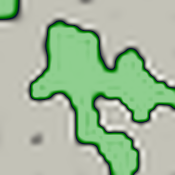
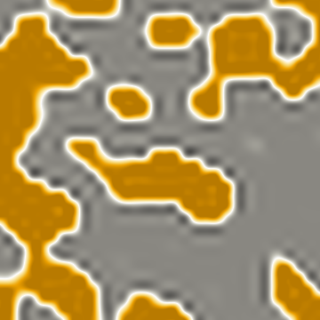
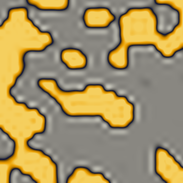

::: {.hero}
[]{.hero-pic style="-webkit-mask-image:url(banner.png);mask-image:url(banner.png)"}
:::

:::: {.split}

::: {.split-left}

Usual methods of additive manufacturing focus on pointwise or static layer by  layer control, examples being 3D printers and photolithography.
These methods have shows their effectivness and are outmost reliable, however lack the scaling and flexibility of self-generating biological and chemical systems [@miotti2025differentiable].
The following experiments show how both straightforward and learnt approaches are able to control the dynamics of a chemical model.
The three approaches used are physics search [@kingma2015adam; @ledimet1986variational; @mallat1993matching; @denoyelle2020sliding], Diffusion models [@huang2024diffusionpde; @karras2022elucidating] and Fourier Neural Operators [@li2021fourier; @kovachki2024neural].

## Background reading

::: {#refs}
:::

:::

::: {.split-right}

## Results

### Physics Search

The goal is to find a simpler starting state than the true one that still grows into the observed final pattern, so the initial condition is found and simplified at the same time. This method searches directly through the Gray-Scott solver, so it needs no training.

::: {.pf-row}

::: {.pf-cell}
::: {.pf-light}

:::

::: {.pf-dark}

:::
:::

::: {.pf-cell}
::: {.pf-light}

:::

::: {.pf-dark}

:::
:::

::: {.pf-cell}
::: {.pf-light}

:::

::: {.pf-dark}

:::
:::

:::

The true starting state (step 50) is a noisy random field. The solver turns it into the true final pattern at step 300 in 250 steps, and only 50 pixels of that final pattern are observed.

::: {.pf-row}

::: {.pf-cell}
::: {.pf-light}

:::

::: {.pf-dark}

:::
:::

::: {.pf-cell}
::: {.pf-light}

:::

::: {.pf-dark}

:::
:::

::: {.pf-cell}
::: {.pf-light}

:::

::: {.pf-dark}

:::
:::

:::

The search found a single blob, described by just 4 numbers (position, width, strength). Its growth over the same 250 steps reproduces the final pattern with a relative error of 0.049 (16x16 grid).

### Blob growth

Here the start is always the same fixed blob, and the goal is to find the parameter maps (d = diffusivity, a = feed, b = kill) that make it grow into a given final state. A diffusion model (DiffusionPDE-style prior) does this, and it is the most robust of the three approaches: one trained network handles every scene.

::: {.pf-row}

::: {.pf-cell}
::: {.pf-light}

:::

::: {.pf-dark}

:::
:::

::: {.pf-cell}
::: {.pf-light}

:::

::: {.pf-dark}

:::
:::

::: {.pf-cell}
::: {.pf-light}

:::

::: {.pf-dark}

:::
:::

:::

::: {.pf-row}

::: {.pf-cell}
::: {.pf-light}

:::

::: {.pf-dark}

:::
:::

::: {.pf-cell}
::: {.pf-light}

:::

::: {.pf-dark}

:::
:::

::: {.pf-cell}
::: {.pf-light}

:::

::: {.pf-dark}

:::
:::

:::

The hidden true parameter maps (shown below as deviation from nominal) grow the blob into the true final pattern over 400 steps (32x32 grid).

::: {.pf-row}

::: {.pf-cell}
::: {.pf-light}

:::

::: {.pf-dark}

:::
:::

::: {.pf-cell}
::: {.pf-light}

:::

::: {.pf-dark}

:::
:::

::: {.pf-cell}
::: {.pf-light}

:::

::: {.pf-dark}

:::
:::

:::

::: {.pf-row}

::: {.pf-cell}
::: {.pf-light}

:::

::: {.pf-dark}

:::
:::

::: {.pf-cell}
::: {.pf-light}

:::

::: {.pf-dark}

:::
:::

::: {.pf-cell}
::: {.pf-light}

:::

::: {.pf-dark}

:::
:::

:::

The maps found by the diffusion model grow the same blob into a re-generated final pattern with a relative error of 0.25. The found maps differ from the true ones, because many different parameter fields give the same pattern.

::: {.pf-row}

::: {.pf-cell}
::: {.pf-light}

:::

::: {.pf-dark}

:::
:::

::: {.pf-cell}
::: {.pf-light}

:::

::: {.pf-dark}

:::
:::

::: {.pf-cell}
::: {.pf-light}

:::

::: {.pf-dark}

:::
:::

:::

::: {.pf-row}

::: {.pf-cell}
::: {.pf-light}

:::

::: {.pf-dark}

:::
:::

::: {.pf-cell}
::: {.pf-light}

:::

::: {.pf-dark}

:::
:::

::: {.pf-cell}
::: {.pf-light}

:::

::: {.pf-dark}

:::
:::

:::

::: {.pf-row}

::: {.pf-cell}
::: {.pf-light}

:::

::: {.pf-dark}

:::
:::

::: {.pf-cell}
::: {.pf-light}

:::

::: {.pf-dark}

:::
:::

::: {.pf-cell}
::: {.pf-light}

:::

::: {.pf-dark}

:::
:::

:::

::: {.pf-row}

::: {.pf-cell}
::: {.pf-light}

:::

::: {.pf-dark}

:::
:::

::: {.pf-cell}
::: {.pf-light}

:::

::: {.pf-dark}

:::
:::

::: {.pf-cell}
::: {.pf-light}

:::

::: {.pf-dark}

:::
:::

:::

The same kind of diffusion model is asked to grow a drawn letter from the blob over 100 steps (16x16). The letters come out recognisable but not exact: drawing a letter is harder than recreating a natural pattern.

### FNO

A Fourier neural operator (FNO) learns the inverse map and answers in a single forward pass. It is the fastest approach: seconds for a whole set of scenes, with no search per scene.

::: {.pf-row}

::: {.pf-cell}
::: {.pf-light}

:::

::: {.pf-dark}

:::
:::

::: {.pf-cell}
::: {.pf-light}

:::

::: {.pf-dark}

:::
:::

::: {.pf-cell}
::: {.pf-light}

:::

::: {.pf-dark}

:::
:::

:::

The true starting state grows into the true final pattern; this is the pattern the operator has to explain.

::: {.pf-row}

::: {.pf-cell}
::: {.pf-light}

:::

::: {.pf-dark}

:::
:::

::: {.pf-cell}
::: {.pf-light}

:::

::: {.pf-dark}

:::
:::

::: {.pf-cell}
::: {.pf-light}

:::

::: {.pf-dark}

:::
:::

:::

From the observed final state the operator returns a starting state at step 50 whose growth over 250 steps matches the final with a relative error of 0.0015. It also checks 8 rotated and mirrored views of the input and polishes the answer briefly through the solver.

::: {.pf-row}

::: {.pf-cell}
::: {.pf-light}

:::

::: {.pf-dark}

:::
:::

::: {.pf-cell}
::: {.pf-light}

:::

::: {.pf-dark}

:::
:::

::: {.pf-cell}
::: {.pf-light}

:::

::: {.pf-dark}

:::
:::

:::

::: {.pf-row}

::: {.pf-cell}
::: {.pf-light}

:::

::: {.pf-dark}

:::
:::

::: {.pf-cell}
::: {.pf-light}

:::

::: {.pf-dark}

:::
:::

::: {.pf-cell}
::: {.pf-light}

:::

::: {.pf-dark}

:::
:::

::: {.pf-cell}
::: {.pf-light}

:::

::: {.pf-dark}

:::
:::

::: {.pf-cell}
::: {.pf-light}

:::

::: {.pf-dark}

:::
:::

:::

The target is a drawn cross ("plus") on the 32x32 grid, and the start is the usual blob in the middle. This example is not from a Fourier operator: it comes from the novelty search, which finds the four parameter maps (d, a, b and the diffusion scale D) by gradient search through the solver. The re-generated final after 300 steps matches the cross with a score (MCC) of 0.84. It is the "nsdp" arm of the novelty search, chosen as the successful example whose kill map b copies the target least (correlation r = -0.08).

:::

::::
