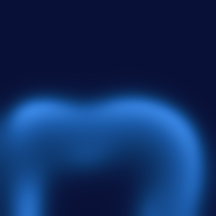
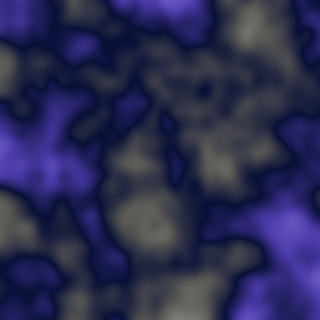
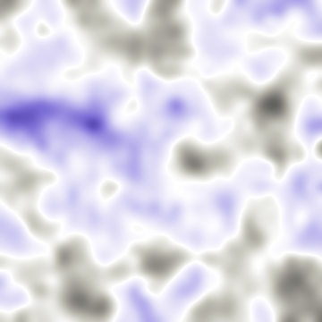
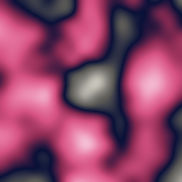
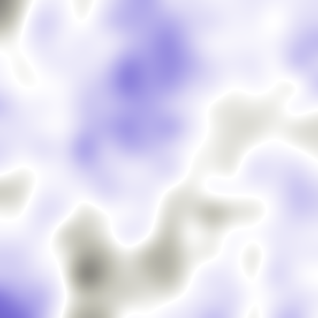
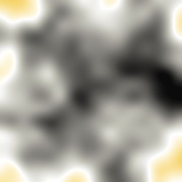
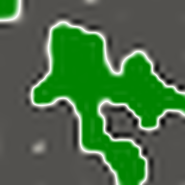
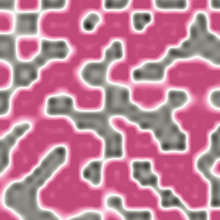
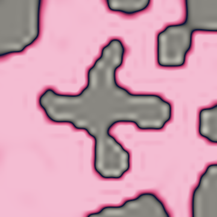

::: {.hero}
[]{.hero-pic style="-webkit-mask-image:url(banner.png);mask-image:url(banner.png)"}
:::

:::: {.split}

::: {.split-left}

Usual methods of additive manufacturing focus on pointwise or static layer by  layer control, examples being 3D printers and photolithography.
These methods have shows their effectivness and are outmost reliable, however lack the scaling and flexibility of self-generating biological and chemical systems [@miotti2025differentiable].
The following experiments show how both straightforward and learnt approaches are able to control the dynamics of a chemical model.
The three approaches used are physics search [@kingma2015adam; @ledimet1986variational; @mallat1993matching; @denoyelle2020sliding], Diffusion models [@huang2024diffusionpde; @karras2022elucidating] and Fourier Neural Operators [@li2021fourier; @kovachki2024neural].

## Background reading

::: {#refs}
:::

:::

::: {.split-right}

## Results

### Physics Search {.heading-center}

The process which needs no learning is an adoptation of a variational algorithm, which manually searches throgh the set of all simple initial conditions (blobs, linees). It produces geometrically simple initial conditions, but works well only on the native Gray-Scott final states with spatially constant coefficients.

::: {.pf-row data-label="Original"}

::: {.pf-cell}
::: {.pf-light}

:::

::: {.pf-dark}

:::
:::

::: {.pf-cell}
::: {.pf-light}

:::

::: {.pf-dark}

:::
:::

::: {.pf-cell}
::: {.pf-light}

:::

::: {.pf-dark}

:::
:::

:::

::: {.pf-row data-label="Found"}

::: {.pf-cell}
::: {.pf-light}

:::

::: {.pf-dark}

:::
:::

::: {.pf-cell}
::: {.pf-light}

:::

::: {.pf-dark}

:::
:::

::: {.pf-cell}
::: {.pf-light}

:::

::: {.pf-dark}

:::
:::

:::

### Diffusion Controller {.heading-center}

This is a learnt U-net architecture and it also allows to find correct initial conditions and is scalable in contrast to physics search.

::: {.pf-row data-label="Original"}

::: {.pf-cell}
::: {.pf-light}

:::

::: {.pf-dark}

:::
:::

::: {.pf-cell}
::: {.pf-light}

:::

::: {.pf-dark}

:::
:::

::: {.pf-cell}
::: {.pf-light}

:::

::: {.pf-dark}

:::
:::

:::
::: {.pf-row data-label="Original maps"}

::: {.pf-cell}
::: {.pf-light}

:::

::: {.pf-dark}

:::
:::

::: {.pf-cell}
::: {.pf-light}

:::

::: {.pf-dark}

:::
:::

::: {.pf-cell}
::: {.pf-light}

:::

::: {.pf-dark}

:::
:::

:::

::: {.pf-row data-label="Found"}

::: {.pf-cell}
::: {.pf-light}

:::

::: {.pf-dark}

:::
:::

::: {.pf-cell}
::: {.pf-light}

:::

::: {.pf-dark}

:::
:::

::: {.pf-cell}
::: {.pf-light}

:::

::: {.pf-dark}

:::
:::

:::

::: {.pf-row data-label="Found maps"}
::: {.pf-cell}
::: {.pf-light}

:::

::: {.pf-dark}

:::
:::

::: {.pf-cell}
::: {.pf-light}

:::

::: {.pf-dark}

:::
:::

::: {.pf-cell}
::: {.pf-light}

:::

::: {.pf-dark}

:::
:::

:::

With this architecture the generation of non-native distributions also becomes possible.
Although far from perfect, the letters are recovered and are recognisable. Also important is that the found parameter fields are non-trivial and many different ones can be found.
The difference between initial possible initial conditions allows for control of the found initial conditions.

::: {.pf-row data-label="X Generation"}

::: {.pf-cell}
::: {.pf-light}

:::

::: {.pf-dark}

:::
:::

::: {.pf-cell}
::: {.pf-light}

:::

::: {.pf-dark}

:::
:::

::: {.pf-cell}
::: {.pf-light}

:::

::: {.pf-dark}

:::
:::

:::

::: {.pf-row data-label="X maps"}

::: {.pf-cell}
::: {.pf-light}

:::

::: {.pf-dark}

:::
:::

::: {.pf-cell}
::: {.pf-light}

:::

::: {.pf-dark}

:::
:::

::: {.pf-cell}
::: {.pf-light}

:::

::: {.pf-dark}

:::
:::

:::

::: {.pf-row data-label="L Generation"}

::: {.pf-cell}
::: {.pf-light}

:::

::: {.pf-dark}

:::
:::

::: {.pf-cell}
::: {.pf-light}

:::

::: {.pf-dark}

:::
:::

::: {.pf-cell}
::: {.pf-light}

:::

::: {.pf-dark}

:::
:::

:::

::: {.pf-row data-label="L maps"}

::: {.pf-cell}
::: {.pf-light}

:::

::: {.pf-dark}

:::
:::

::: {.pf-cell}
::: {.pf-light}

:::

::: {.pf-dark}

:::
:::

::: {.pf-cell}
::: {.pf-light}

:::

::: {.pf-dark}

:::
:::

:::

### Fourier Neural Operator {.heading-center}

While the Diffusion Controller needs multiple passes to generate the initial condition, the FNO has an advantage of only needing one forward pass, whcih hugely saves computational time.
It can recreate both the native Gray-Scott patterns and selected shapes. 

::: {.pf-row data-label="Original"}

::: {.pf-cell}
::: {.pf-light}

:::

::: {.pf-dark}

:::
:::

::: {.pf-cell}
::: {.pf-light}

:::

::: {.pf-dark}

:::
:::

::: {.pf-cell}
::: {.pf-light}

:::

::: {.pf-dark}

:::
:::

:::

::: {.pf-row data-label="Found"}

::: {.pf-cell}
::: {.pf-light}

:::

::: {.pf-dark}

:::
:::

::: {.pf-cell}
::: {.pf-light}

:::

::: {.pf-dark}

:::
:::

::: {.pf-cell}
::: {.pf-light}

:::

::: {.pf-dark}

:::
:::
:::

Although in case of shapes the recovered parameter fields mirror the target trivially, unless additional selective techniqeus are applied.

::: {.pf-row data-label="FNO Plus Generation"}

::: {.pf-cell}
::: {.pf-light}

:::

::: {.pf-dark}

:::
:::

::: {.pf-cell}
::: {.pf-light}

:::

::: {.pf-dark}

:::
:::

::: {.pf-cell}
::: {.pf-light}

:::

::: {.pf-dark}

:::
:::

:::

::: {.pf-row data-label="FNO Plus maps"}

::: {.pf-cell}
::: {.pf-light}

:::

::: {.pf-dark}

:::
:::

::: {.pf-cell}
::: {.pf-light}

:::

::: {.pf-dark}

:::
:::

::: {.pf-cell}
::: {.pf-light}

:::

::: {.pf-dark}

:::
:::

:::

::::

:::
