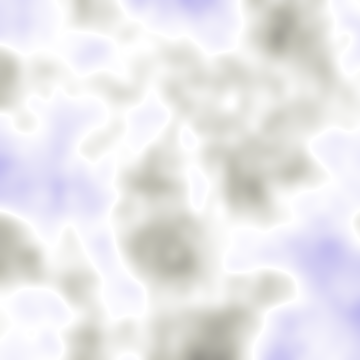
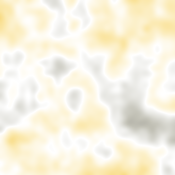
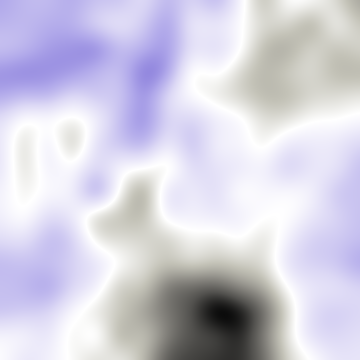
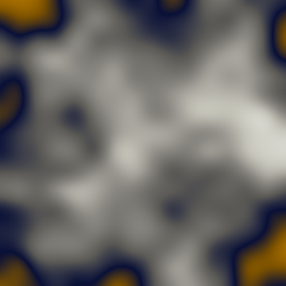
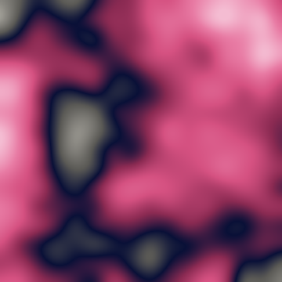

::: {.hero}
[]{.hero-pic style="-webkit-mask-image:url(banner.png);mask-image:url(banner.png)"}
:::

:::: {.split}

::: {.split-left}

Usual methods of additive manufacturing focus on pointwise or static layer by  layer control, examples being 3D printers and photolithography.
These methods have shows their effectivness and are outmost reliable, however lack the scaling and flexibility of self-generating biological and chemical systems [@miotti2025differentiable].
The following experiments show how both straightforward and learnt approaches are able to control the dynamics of a chemical model.
The three approaches used are physics search [@kingma2015adam; @ledimet1986variational; @mallat1993matching; @denoyelle2020sliding], Diffusion models [@huang2024diffusionpde; @karras2022elucidating] and Fourier Neural Operators [@li2021fourier; @kovachki2024neural].

## Background reading

::: {#refs}
:::

:::

::: {.split-right}

## Results

### Physics Search

::: {.stub}
Introduction to be written.
:::

::: {.pf-row}

::: {.pf-cell}
::: {.pf-light}

:::

::: {.pf-dark}

:::
:::

::: {.pf-cell}
::: {.pf-light}

:::

::: {.pf-dark}

:::
:::

::: {.pf-cell}
::: {.pf-light}

:::

::: {.pf-dark}

:::
:::

:::

::: {.stub}
Description to be written.
:::

::: {.pf-row}

::: {.pf-cell}
::: {.pf-light}

:::

::: {.pf-dark}

:::
:::

::: {.pf-cell}
::: {.pf-light}

:::

::: {.pf-dark}

:::
:::

::: {.pf-cell}
::: {.pf-light}

:::

::: {.pf-dark}

:::
:::

:::

::: {.stub}
Description to be written.
:::

### Blob growth

::: {.stub}
Introduction to be written.
:::

::: {.pf-row}

::: {.pf-cell}
::: {.pf-light}

:::

::: {.pf-dark}

:::
:::

::: {.pf-cell}
::: {.pf-light}

:::

::: {.pf-dark}

:::
:::

::: {.pf-cell}
::: {.pf-light}

:::

::: {.pf-dark}

:::
:::

:::

::: {.pf-row}

::: {.pf-cell}
::: {.pf-light}

:::

::: {.pf-dark}

:::
:::

::: {.pf-cell}
::: {.pf-light}

:::

::: {.pf-dark}

:::
:::

::: {.pf-cell}
::: {.pf-light}

:::

::: {.pf-dark}

:::
:::

:::

::: {.stub}
Description to be written.
:::

::: {.pf-row}

::: {.pf-cell}
::: {.pf-light}

:::

::: {.pf-dark}

:::
:::

::: {.pf-cell}
::: {.pf-light}

:::

::: {.pf-dark}

:::
:::

::: {.pf-cell}
::: {.pf-light}

:::

::: {.pf-dark}

:::
:::

:::

::: {.pf-row}

::: {.pf-cell}
::: {.pf-light}

:::

::: {.pf-dark}

:::
:::

::: {.pf-cell}
::: {.pf-light}

:::

::: {.pf-dark}

:::
:::

::: {.pf-cell}
::: {.pf-light}

:::

::: {.pf-dark}

:::
:::

:::

::: {.stub}
Description to be written.
:::

::: {.pf-row}

::: {.pf-cell}
::: {.pf-light}

:::

::: {.pf-dark}

:::
:::

::: {.pf-cell}
::: {.pf-light}

:::

::: {.pf-dark}

:::
:::

::: {.pf-cell}
::: {.pf-light}

:::

::: {.pf-dark}

:::
:::

:::

::: {.pf-row}

::: {.pf-cell}
::: {.pf-light}

:::

::: {.pf-dark}

:::
:::

::: {.pf-cell}
::: {.pf-light}

:::

::: {.pf-dark}

:::
:::

::: {.pf-cell}
::: {.pf-light}

:::

::: {.pf-dark}

:::
:::

:::

::: {.pf-row}

::: {.pf-cell}
::: {.pf-light}

:::

::: {.pf-dark}

:::
:::

::: {.pf-cell}
::: {.pf-light}

:::

::: {.pf-dark}

:::
:::

::: {.pf-cell}
::: {.pf-light}

:::

::: {.pf-dark}

:::
:::

:::

::: {.pf-row}

::: {.pf-cell}
::: {.pf-light}

:::

::: {.pf-dark}

:::
:::

::: {.pf-cell}
::: {.pf-light}

:::

::: {.pf-dark}

:::
:::

::: {.pf-cell}
::: {.pf-light}

:::

::: {.pf-dark}

:::
:::

:::

::: {.stub}
Description to be written.
:::

### FNO

::: {.stub}
Introduction to be written.
:::

::: {.pf-row}

::: {.pf-cell}
::: {.pf-light}

:::

::: {.pf-dark}

:::
:::

::: {.pf-cell}
::: {.pf-light}

:::

::: {.pf-dark}

:::
:::

::: {.pf-cell}
::: {.pf-light}

:::

::: {.pf-dark}

:::
:::

:::

::: {.stub}
Description to be written.
:::

::: {.pf-row}

::: {.pf-cell}
::: {.pf-light}

:::

::: {.pf-dark}

:::
:::

::: {.pf-cell}
::: {.pf-light}

:::

::: {.pf-dark}

:::
:::

::: {.pf-cell}
::: {.pf-light}

:::

::: {.pf-dark}

:::
:::

:::

::: {.stub}
Description to be written.
:::

::: {.pf-row}

::: {.pf-cell}
::: {.pf-light}

:::

::: {.pf-dark}

:::
:::

::: {.pf-cell}
::: {.pf-light}

:::

::: {.pf-dark}

:::
:::

::: {.pf-cell}
::: {.pf-light}

:::

::: {.pf-dark}

:::
:::

:::

::: {.stub}
Description to be written.
:::

:::

::::
